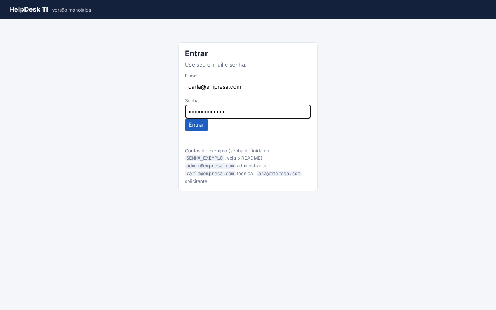
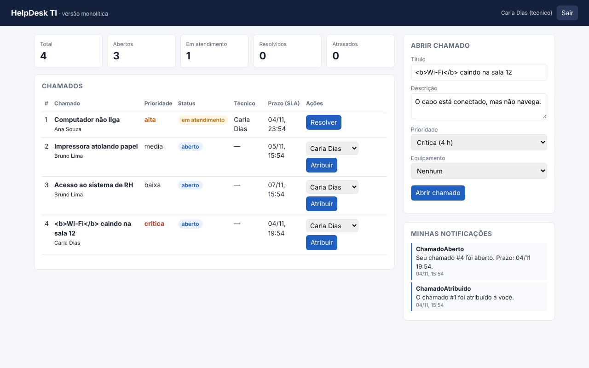
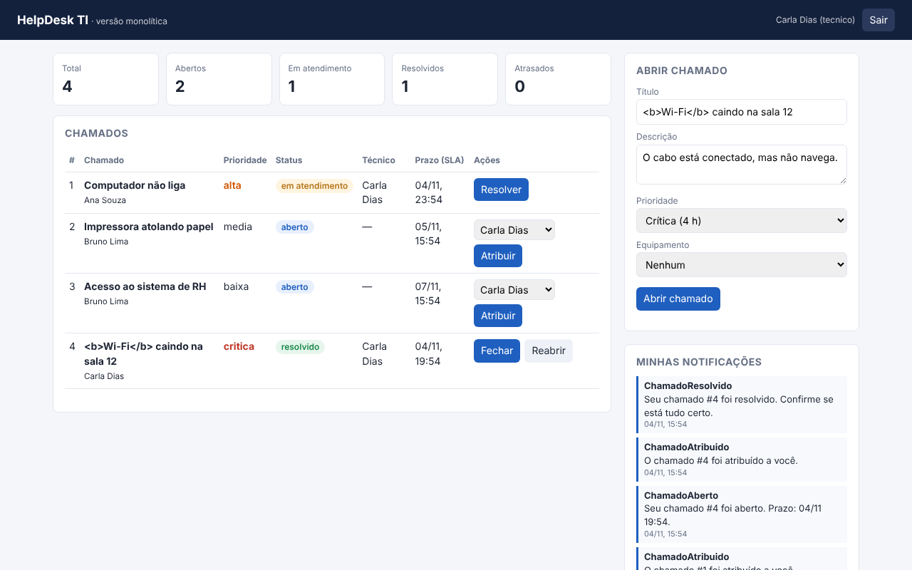
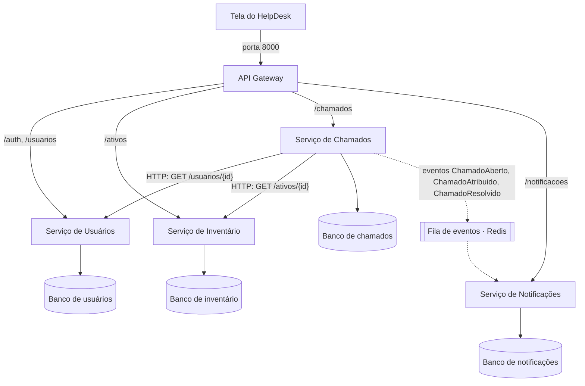

# HelpDesk TI · versão em microsserviços

> 🎥 **Vídeo de demonstração:** _cole aqui o link do vídeo (YouTube não listado ou Google Drive)_

Sistema de chamados de TI (no estilo de um GLPI simplificado), feito em **Python + FastAPI**.
Começou como um **monólito** (uma aplicação, um banco, uma implantação) e foi separado em
**microsserviços**, sem perder nenhuma funcionalidade. O enunciado está em [DESAFIO.md](DESAFIO.md).

| Login | Painel do técnico | Chamado resolvido |
|---|---|---|
|  |  |  |

## Arquitetura



| Contêiner | O que faz | Porta exposta |
|---|---|---|
| `gateway` | Ponto único de entrada: serve a tela e encaminha cada rota ao serviço certo | **8000** (só em `127.0.0.1`) |
| `usuarios` | Login (emite o token JWT) e cadastro de usuários | nenhuma |
| `inventario` | Cadastro e consulta de equipamentos | nenhuma |
| `chamados` | Abre, atribui, muda status, comenta e mostra o painel | nenhuma |
| `notificacoes` | Lê os eventos da fila e grava os avisos (bônus) | nenhuma |
| `fila` | Redis: fila de eventos entre Chamados e Notificações (bônus) | nenhuma |
| `segredo` | Gera o segredo do JWT na primeira vez e termina | nenhuma |

### Como os serviços conversam

- **Tela → Gateway:** a tela chama as mesmas rotas de antes (`/chamados`, `/ativos`...). O gateway olha o
  primeiro pedaço do caminho e repassa ao serviço dono daquela rota, junto com o token.
- **Chamados → Usuários e Inventário (HTTP):** ao abrir um chamado com equipamento, o Chamados faz
  `GET http://inventario:8000/ativos/{id}`; ao atribuir, faz `GET http://usuarios:8000/usuarios/{id}` e confere
  se o perfil é `tecnico`. O token do usuário vai junto no cabeçalho `Authorization` (veja `servicos/chamados/app/clientes.py`).
- **Chamados → Notificações (evento):** o Chamados coloca o evento na fila do Redis e segue a vida.
  O Notificações lê a fila no seu ritmo (veja `servicos/chamados/app/eventos.py` e `servicos/notificacoes/app/consumidor.py`).

```
servicos/
├── gateway/        # FastAPI + httpx: tela (web/) e encaminhamento das rotas
├── usuarios/       # auth/ (login, senhas, tokens) e usuarios/
├── inventario/     # inventario/ e auth/ (só confere o token)
├── chamados/       # chamados/, clientes.py (HTTP), eventos.py (fila) e auth/
└── notificacoes/   # notificacoes/, consumidor.py (fila) e auth/
```

Cada pasta é um projeto independente, com `Dockerfile`, `requirements.txt` e testes próprios.

## Como rodar

```bash
docker compose up --build
```

Não é preciso nenhum ajuste manual: na primeira vez, o contêiner `segredo` gera um segredo aleatório para o JWT.
Depois abra **http://localhost:8000**.

```bash
docker compose ps        # todos os contêineres no ar
docker compose down      # desliga tudo (os bancos ficam nos volumes)
docker compose down -v   # desliga e apaga os bancos
```

### Contas de acesso

Todos usam a senha **`Helpdesk2026`** (só para aula; em produção use `DADOS_EXEMPLO=0`).

| E-mail | Perfil |
|---|---|
| `admin@empresa.com` | Administrador |
| `carla@empresa.com` | Técnica (use para o fluxo completo) |
| `diego@empresa.com` | Técnico |
| `ana@empresa.com` | Solicitante (não vê os chamados do Bruno) |
| `bruno@empresa.com` | Solicitante |

### Configuração (opcional)

Copie `.env.example` para `.env` para mudar algo. Se `JWT_SEGREDO` estiver no `.env`, ele tem prioridade
sobre o segredo gerado. O `.env` nunca vai para o GitHub (está no `.gitignore`).

## Demonstrações

**Quais serviços estão no ar**

```bash
curl http://localhost:8000/saude
```

**Chamada sem token recebe 401**

```bash
curl -i http://localhost:8000/chamados
```

**Bancos separados:** cada serviço tem o próprio volume.

```bash
docker volume ls
docker compose exec usuarios ls /dados
docker compose exec chamados ls /dados
```

**Falha de um serviço**

```bash
docker compose stop inventario
```

Com o Inventário parado, a lista de usuários e de chamados continua funcionando, e abrir um chamado
**com equipamento** responde na hora com *"O serviço de Inventário está fora do ar"* (503), sem travar.
Abrir um chamado **sem** equipamento continua funcionando. Para voltar:

```bash
docker compose start inventario
```

**Eventos (bônus):** com `docker compose stop notificacoes`, os chamados continuam sendo abertos; os eventos
esperam na fila e viram avisos quando o serviço volta (`docker compose start notificacoes`).
Para ver os eventos chegando: `docker compose logs -f notificacoes`.

## Testes

Cada serviço tem os próprios testes, incluindo os **testes de segurança** adaptados a ele:

```bash
cd servicos/chamados
pip install -r requirements-dev.txt
pytest -q
```

| Serviço | O que os testes cobrem |
|---|---|
| usuarios | login, bloqueio de tentativas, tokens falsos/vencidos/`alg: none`, hash de senha, permissões, segredo obrigatório |
| inventario | cadastro, consulta, token conferido no serviço, permissões, validação |
| chamados | SLA, transições, permissões, **503 quando Usuários ou Inventário caem**, timeout, token repassado, fila fora do ar |
| notificacoes | eventos viram avisos, cada um vê só os seus, eventos inválidos descartados |
| gateway | cada rota vai ao serviço certo, 503/504 em falhas, limite de tamanho, cabeçalhos de segurança da tela |

No GitHub Actions, os testes de cada serviço rodam separados, o `pip-audit` confere as dependências e
um job sobe tudo com `docker compose` e confere o `/saude`.

## Rotas

Todas passam pelo gateway (porta 8000) e exigem login, exceto `/auth/login` e `/saude`.

| Método | Rota | Serviço | Quem pode |
|---|---|---|---|
| POST | `/auth/login` | Usuários | Todos |
| GET | `/auth/eu` | Usuários | Logado |
| POST / GET | `/usuarios`, `GET /usuarios/{id}` | Usuários | Admin cria / logado consulta |
| POST / GET | `/ativos`, `GET /ativos/{id}` | Inventário | Técnico e admin criam / logado consulta |
| POST / GET | `/chamados` | Chamados | Logado (solicitante vê só os seus) |
| GET | `/chamados/painel` | Chamados | Logado |
| PATCH | `/chamados/{id}/atribuir` | Chamados | Técnico e admin |
| PATCH | `/chamados/{id}/status` | Chamados | Técnico e admin (solicitante: fechar ou reabrir) |
| POST | `/chamados/{id}/comentarios` | Chamados | Envolvidos |
| GET | `/notificacoes` | Notificações | Logado (só as suas) |
| GET | `/saude` | Gateway | Todos |

## Decisões tomadas

1. **O login fica só no serviço de Usuários; os outros conferem o token sozinhos.** O token JWT já traz o
   `id` e o `perfil` e é assinado com o `JWT_SEGREDO`. Assim, Inventário, Chamados e Notificações não precisam
   da tabela de usuários nem de perguntar ao serviço de Usuários a cada requisição. Contrapartida: se um usuário
   for desativado, o token dele vale até expirar (60 minutos).
2. **O gateway não confere o token, só repassa.** Cada serviço confere por conta própria, então um serviço
   nunca confia cegamente em quem chama.
3. **Sem chaves estrangeiras entre serviços.** O chamado guarda só os números `solicitante_id`, `tecnico_id`
   e `ativo_id`; quem garante que eles existem é o serviço dono do dado, por HTTP, no momento da ação.
4. **Timeout e 503.** O Chamados espera no máximo 3 segundos por outro serviço; se ele estiver fora do ar ou
   demorar, responde 503 com uma mensagem clara. O gateway também responde 503 (fora do ar) ou 504 (demora).
5. **SQLite com um volume por serviço.** Cada serviço tem o próprio arquivo de banco em um volume só dele.
   É simples para a aula; em produção, cada um teria o próprio PostgreSQL.
6. **Segredo sem ajuste manual.** O contêiner `segredo` gera um segredo aleatório na primeira vez e o
   entrega aos serviços em um volume somente leitura. Nenhum segredo fica no código.
7. **Eventos com Redis (bônus).** Uma lista do Redis serve de fila: o Chamados publica e o Notificações
   consome. Se o Notificações cair, os eventos esperam na fila; se a fila cair, o chamado é salvo mesmo assim.
8. **Dados de exemplo por serviço.** Cada serviço cria os seus; o Chamados usa os ids fixos dos usuários e
   equipamentos de exemplo, sem chamar a rede na inicialização.

### O que ficou melhor e o que ficou mais difícil

- ✅ Cada serviço pode ser publicado, escalado e testado sozinho, e um serviço fora do ar não derruba os outros.
- ✅ Cada time cuida do seu serviço e do seu banco.
- ⚠️ Agora existe a rede no meio: é preciso tratar timeout, serviço fora do ar e mensagens claras de erro.
- ⚠️ Não há mais transação única nem chave estrangeira entre bancos; a consistência é conferida por HTTP.
- ⚠️ Mais peças para subir e monitorar (seis contêineres em vez de um).

## Segurança

Veja [SECURITY.md](SECURITY.md).
